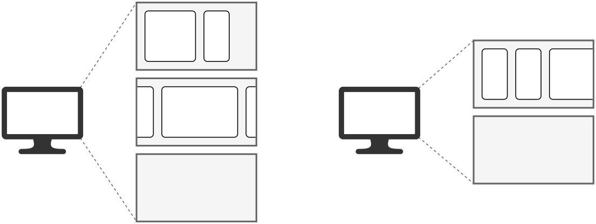

### Overview

Tiri has dynamic workspaces that can move between monitors.

Each monitor contains an independent set of workspaces arranged vertically.
You can switch between workspaces on a monitor with `focus-workspace-down` and `focus-workspace-up`.
Empty workspaces "in the middle" automatically disappear when you switch away from them.

There's always one empty workspace at the end (at the bottom) of every monitor.
When you open a window on this empty workspace, a new empty workspace will immediately appear further below it.

You can move workspaces up and down on the monitor with `move-workspace-up/down`.
The way to put a window on a new workspace "in the middle" is to put it on the last (empty) workspace, then move the workspace up to where you need.

Here's a visual representation that shows two monitors and their workspaces.
The left monitor has three workspaces (two with windows, plus one empty), and the right monitor has two workspaces (one with windows, plus one empty).

<picture>
    <source media="(prefers-color-scheme: dark)" srcset="./img/workspaces-dark.png">
    
</picture>

You can move a workspace to a different monitor using binds like `move-workspace-to-monitor-left/right/up/down` and `move-workspace-to-monitor-next/previous`.

When you disconnect a monitor, its workspaces will automatically move to a different monitor.
But, they will also "remember" their original monitor, so when you reconnect it, the workspaces will automatically move back to it.
To reduce surprising workspace movement, regular workspaces will "forget" their monitor when you open a new window there.
[Named workspaces](./Configuration:-Named-Workspaces.md), on the other hand, will remember their original monitor until you explicitly move them to a different one.

> [!TIP]
> From other tiling WMs, you may be used to thinking about workspaces like this: "These are all of my workspaces. I can show workspace X on my first monitor, and workspace Y on my second monitor."
> In tiri, instead, think like this: "My first monitor contains these workspaces, including X and Y, and my second monitor contains these other workspaces. I can switch my first monitor to workspace X or Y. I can move workspace Y to my second monitor to show it there."

### Addressing workspaces by index

Several actions in tiri can address workspaces "by index": `focus-workspace 2`, `move-column-to-workspace 4`.
For numeric references, this index maps to workspace name `"N"` globally, like i3/sway.
So, `focus-workspace 2` resolves workspace `"2"` regardless of monitor-local ordering.
If it doesn't exist yet, it is created lazily.

Auto-created numeric workspaces are temporary: if they remain empty and become unfocused, they disappear.

When you want to have a more permanent workspace, you can create a [named workspace](./Configuration:-Named-Workspaces.md) in the config or via the `set-workspace-name` action.
You can refer to named workspaces by name, e.g. `focus-workspace "browser"`, and they won't disappear when they become empty.

> [!TIP]
> You can try to emulate static workspaces by creating workspaces named "one", "two", "three", ..., and binding keys to `focus-workspace "one"`, `focus-workspace "two"`, ...
> This can work to some extent, but it can become somewhat confusing, since you can still move these workspaces up and down and between monitors.
>
> If you're coming from a static workspace WM, consider *not* doing that, but instead trying the dynamic workspace approach with focusing and moving up/down instead of by index.

### Example workflow

Here is an example of how dynamic workspaces can be used effectively.

A common setup is to keep a browser on the topmost workspace, then one workspace per project or task.
On a single workspace, multiple windows are arranged in the tiling layout using splits, tabs, or stacked containers for quick switching.
When a workspace gets too cluttered, some windows can be moved to a new workspace or grouped into tabbed/stacked containers to stay organized.

Workspaces can be actively moved up and down to keep the most relevant ones accessible in one motion.
For example, frequently switching between a browser and a project workspace is easy: just move the project workspace right below the browser, so a single `focus-workspace-up/down` gets you where you need.
